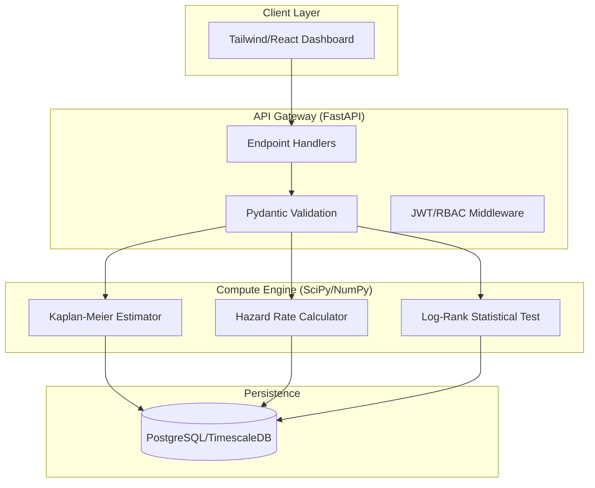

# ARCHITECTURE.md: SurvivalChurn Matrix

## 1. High-Level System Topology
SurvivalChurn Matrix utilizes a decoupled architecture separating the heavy-duty statistical compute engine from the asynchronous API orchestration layer.



## 2. Tech Stack Rationale

### 70% Battle-Tested (Stability)
*   **Python 3.11+**: Leverages `TaskGroup` and improved exception handling for robust async orchestration.
*   **NumPy/SciPy**: Industry standard for vectorized survival analysis; avoids Python-level loops for O(n) operations.
*   **FastAPI**: High-performance ASGI framework; native Pydantic integration ensures strict schema enforcement for cohort data.
*   **PostgreSQL**: Relational integrity for customer event logs; TimescaleDB extension utilized for time-series partitioning.

### 30% Bleeding-Edge (Performance/DX)
*   **Pydantic V2**: Rust-based core for sub-millisecond validation of large-scale cohort datasets.
*   **Tailwind CSS + Shadcn/UI**: Component-driven dashboarding for rapid iteration of complex survival visualizations.
*   **Uvicorn + uvloop**: High-concurrency event loop management for non-blocking I/O during heavy statistical computation.

## 3. Module & Directory Layout

```text
/survival_churn
├── api/                # FastAPI routes and dependency injection
├── core/               # Statistical engine (KM, Hazard, Log-Rank)
│   ├── estimators.py   # Kaplan-Meier implementation
│   ├── statistics.py   # Log-rank test logic
│   └── hazards.py      # Nelson-Aalen/Cox hazard functions
├── schemas/            # Pydantic models for cohort definitions
├── db/                 # Database connection pooling and migrations
├── services/           # Business logic layer (orchestration)
├── tests/              # Pytest suite (unit/integration/property-based)
└── main.py             # Application entry point
```

## 4. Data Flow & Component Interaction Pipeline

1.  **Ingestion**: Client POSTs cohort event data (customer_id, event_time, event_type) to `/api/v1/analyze`.
2.  **Validation**: Pydantic `CohortSchema` enforces strict typing and ensures `event_time` is monotonically increasing per `customer_id`.
3.  **Orchestration**: `ServiceLayer` dispatches data to the `ComputeEngine`.
4.  **Computation**:
    *   `KM Estimator` processes the survival function $S(t) = \prod_{t_i \le t} (1 - \frac{d_i}{n_i})$.
    *   `Hazard Calculator` derives the cumulative hazard function $H(t) = -\ln(S(t))$.
    *   `Log-Rank Test` computes the Chi-squared statistic for cohort comparison.
5.  **Response**: Serialized JSON payload returned to the dashboard for rendering via D3.js/Chart.js.

## 5. Security & Boundary Isolation

*   **Boundary Isolation**: The `ComputeEngine` is strictly functional and stateless. It accepts only validated Pydantic objects, preventing injection attacks or memory-unsafe data processing.
*   **Memory Management**: Large datasets are processed using NumPy memory-mapping (`np.memmap`) to prevent OOM (Out-of-Memory) errors during large-scale cohort analysis.
*   **Authentication**: FastAPI `Security` dependencies enforce JWT-based scoping. Each request is scoped to a `tenant_id`, ensuring cross-tenant data isolation at the database query level (Row-Level Security).
*   **Input Sanitization**: All incoming time-series data is cast to `np.float64` or `np.datetime64` within the validation layer to prevent type-confusion vulnerabilities.